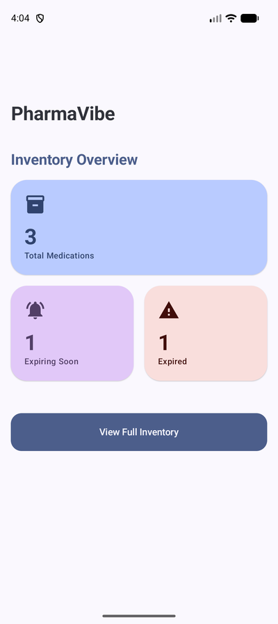
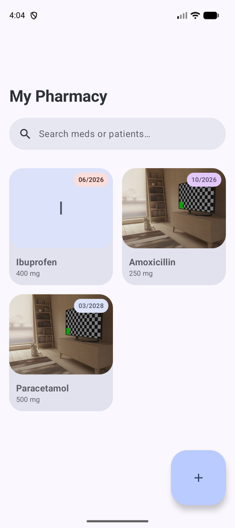
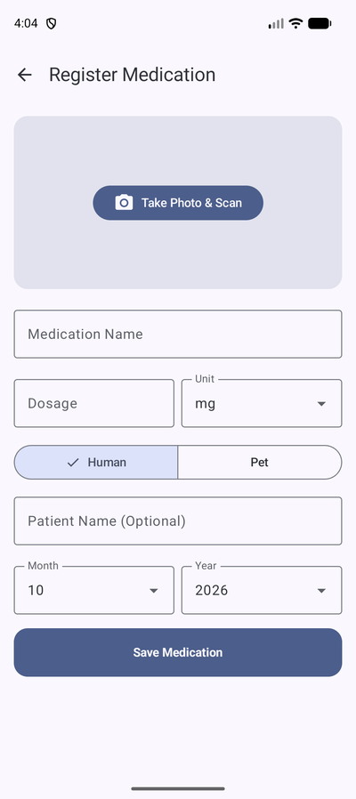
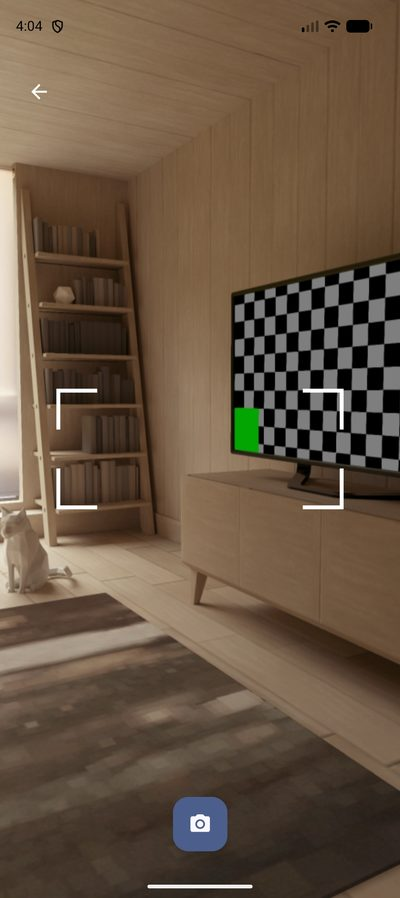
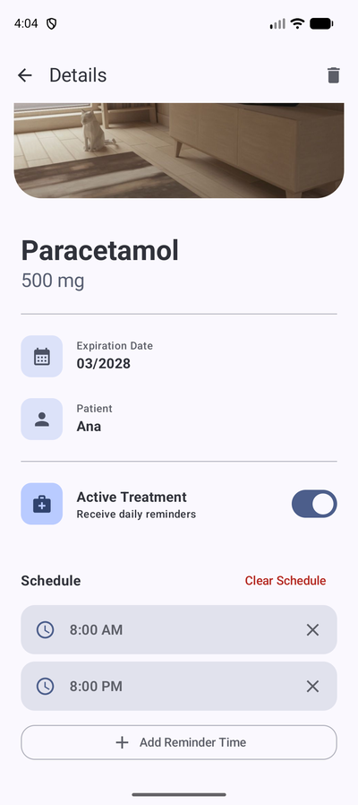
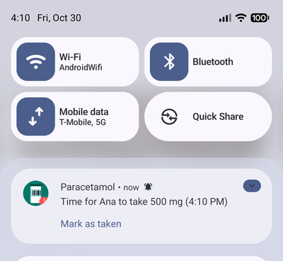

# PharmaVibe (Internal Project: ControlFarmacia)


> Smart medication expiration tracker using CameraX & ML Kit. Started as a 100% "vibe code" experiment generated with the Panda 2 AI agent in Android Studio, then reviewed and cleaned up by hand.

## The AI "Vibe Code" Experiment
The initial architecture, UI and feature set were generated via prompting with the **Panda 2 AI Agent** within Android Studio. A later pass reviewed that output, fixed the bugs it shipped with and brought the code up to the practices listed below. The commit history keeps both stages.

## Project Brief
PharmaVibe (ControlFarmacia) keeps track of a home pharmacy. Register a medication by pointing the camera at the box (the name is read with on-device OCR), add the dosage, who it is for (a person or a pet) and the expiration month. The app warns before medications expire and, while a medication is "in treatment", reminds you of each intake with daily alarms.

## Screenshots

| Dashboard | Inventory | Registration |
| :---: | :---: | :---: |
|  |  |  |

| Camera + live OCR | Detail with treatment schedule | Intake reminder |
| :---: | :---: | :---: |
|  |  |  |

Taken on a Pixel 9a emulator (Android 17); the "box" in the photos is the emulator's virtual scene.

## Key Features
* **Camera registration:** take a photo of the packaging; ML Kit text recognition fills in the medication name and, when the box shows one, the expiration date ("EXP 03/2028", "CAD MAR 28", "Vence 2028-03"…).
* **Inventory dashboard:** totals, expiring-this-month, expired, running-low and doses-taken-today counts, plus a searchable grid with photos, filters (in treatment, expiring, running low, per patient) and sorting.
* **Edit anything later:** every field, including the photo, can be changed from the detail screen.
* **Expiration and stock alerts:** a daily WorkManager job notifies about expired, soon-to-expire and almost-finished medications.
* **Treatment reminders:** exact alarms at the times you choose, re-armed after reboots, time changes and app updates. If Android is not allowing exact alarms, the app says so and links to the setting.
* **Dose log:** "Mark as taken" on the notification or "Taken now" on the detail screen records the dose and consumes one unit from the stock you track.
* **English and Spanish** UI.

## Architecture

```
domain/      Medication and Intake models, ExpiryStatus, ExpiryDateParser (OCR), repository/scheduler/photo-store interfaces (pure Kotlin)
data/        Room (entities, DAOs, migrations, mapper), AlarmManager scheduler and receivers, notifications, WorkManager, photo storage
di/          Hilt modules (database, bindings, Clock)
ui/          Compose screens + ViewModels: dashboard, home, registration, detail; camera + OCR analyzer; theme
```

* ViewModels expose a single `StateFlow` of UI state and depend only on domain interfaces, so they are unit-tested with in-memory fakes (`app/src/test`).
* `Clock` is injected wherever "today" matters.
* Room schema is exported to `app/schemas/`; destructive migration is only allowed from the pre-release versions 1 and 2.
* Navigation uses type-safe routes (`@Serializable` route objects).

## Technical Stack

| Category | Technology |
| :--- | :--- |
| **Language** | Kotlin 2.4 (built into AGP 9.5), Java 17 target, compile/target SDK 37 |
| **Architecture** | MVVM with a small domain layer |
| **Dependency Injection** | Dagger-Hilt |
| **UI** | Jetpack Compose (Material 3), Navigation Compose, shared element transitions |
| **Persistence** | Room (KSP) |
| **Media & Vision** | CameraX, ML Kit Text Recognition, Coil 3 |
| **Background** | WorkManager (expiration checks), AlarmManager (intake reminders) |
| **Concurrency** | Kotlin Coroutines & Flow |
| **Tests** | JUnit 4, kotlinx-coroutines-test |

## Permissions

| Permission | Why |
| :--- | :--- |
| `CAMERA` | Photo of the packaging and live OCR. Declared as optional hardware. |
| `POST_NOTIFICATIONS` | Expiration alerts and intake reminders (asked on first launch and when a treatment is enabled). |
| `SCHEDULE_EXACT_ALARM` | Reminders at the exact minute. If the user does not grant it, reminders fall back to inexact alarms. |
| `RECEIVE_BOOT_COMPLETED` | Re-arm the reminders after a reboot. |

No network access: everything (OCR included) runs on the device.

## What the review changed (2026-10-30)

The generated code looked finished but shipped with real bugs: the camera kept running after leaving the camera view, deleted medications left their photos behind, reminder alarms drifted and were lost on reboot, notification ids collided and any schema change wiped the database. The review fixed those, moved the Room entity out of the UI behind a small domain model, put every string into resources (with a Spanish translation), removed dead code and unused permissions, added unit tests, cleaned lint to zero and upgraded the whole toolchain (Gradle 9.8, AGP 9.5 with built-in Kotlin 2.4, SDK 37, Compose BOM 2026.09, Room 2.8, Hilt 2.60, Coil 3). The full list of findings, decisions and open ideas lives in [`PLAN.md`](PLAN.md) (Spanish).

Everything was verified on a Pixel 9a emulator running Android 17: registration with OCR, a real reminder alarm firing at the scheduled minute, "mark as taken", rescheduling for the next day and deletion with no orphan alarms or photos.

## Building and testing

```
./gradlew :app:assembleDebug       # debug APK
./gradlew :app:assembleRelease     # release APK (R8 + resource shrinking)
./gradlew :app:testDebugUnitTest   # 25 unit tests (domain, mapper, ids, view models)
./gradlew :app:lintDebug           # lint report (currently clean)
```

Requires JDK 17 and Android SDK 37 (Gradle 9.8, AGP 9.5).

To try the reminders on an emulator without waiting for the exact-alarm permission prompt:

```
adb shell appops set com.aviva.controlfarmacia SCHEDULE_EXACT_ALARM allow
adb shell dumpsys alarm | grep -A2 action.REMINDER   # scheduled reminders
```

## Branches

`main` and `ocr-pivot` point to the same reviewed code. The barcode-scanning version that preceded the OCR pivot is still in the history before commit `7767893` ("Auto read the medicine").
